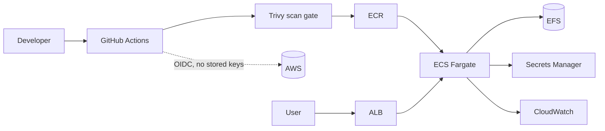

# EVI: AI-Powered Digital Forensics Platform

A web-based platform for analyzing Cellebrite UFDR and XML reports with natural-language questions, pattern detection and AI-generated insights. It ships with a Docker setup and a complete AWS deployment pipeline (Terraform, GitHub Actions, ECS Fargate).

## Demo

https://github.com/user-attachments/assets/186a8f49-d874-42e0-a21b-9a9d3dca57f3

> **Use synthetic or properly authorized data only.** The demo data is fictional. Never upload real case data to a public or shared deployment.

## Quickstart (Docker)

```bash
git clone https://github.com/debu-devesh/EVI-Platform.git && cd EVI-Platform
cp .env.example .env        # then set OPENROUTER_API_KEY in .env
docker build -t evi-app .
docker run -p 5000:5000 -v evi-persist:/persist --env-file .env evi-app
```

Open http://localhost:5000 and create an account.

- Get an API key at [openrouter.ai/keys](https://openrouter.ai/keys) and set a credit limit on it. Never commit keys to the repo.
- The `-v evi-persist:/persist` flag keeps accounts and uploads between restarts.
- To run without Docker, or to use a local LLM through LM Studio, see [docs/SETUP_GUIDE.md](docs/SETUP_GUIDE.md).

## Features

**Forensic analysis**
- Parses Cellebrite UFDR ZIP files, standalone XML reports and UFDR JSON
- Streaming XML parser for large reports (1M+ lines) with SQLite storage for fast queries
- Extracts contacts, messages, calls, chats, locations and device metadata
- Covers WhatsApp, Telegram, SMS, Twitter, Instagram, Snapchat, LINE and more
- Pattern detection for communication patterns, activity timelines and relationships

**AI assistant**
- Natural-language questions about the evidence, answered by a local model (LM Studio) or a hosted one (OpenRouter)
- Query-aware data retrieval so the model sees only the relevant records, up to 32,768 tokens of context
- Prompts grounded in retrieved case data to reduce hallucination
- Streaming responses and adaptive answer style based on query complexity
- Fuzzy matching on names and phone numbers, and cross-table search

**Case and session management**
- Case dashboard with creation, search, metadata and notes
- Multiple evidence files per case
- Saved analysis sessions with persistent chat history

**Security and access control**
- Role-based access control with four roles: Admin, Investigator, Viewer, Auditor
- bcrypt password hashing, session timeouts and CAPTCHA on login and signup
- Fernet encryption (AES-128-CBC with HMAC-SHA256) for sensitive fields and stored files
- SHA-256 hashing of uploaded files for integrity checks
- Audit log of security-relevant actions with timestamps and IP addresses, plus a log viewer

**Reporting**
- Statistics dashboard and timeline analysis
- PDF report generation

## DevOps and infrastructure

EVI ships with a container and cloud deployment pipeline, built and debugged end to end.



| Area | What is implemented |
|---|---|
| Containers | Docker image with a persistent volume for databases and uploads |
| Infrastructure as Code | Terraform: VPC, ALB, ECS Fargate, ECR, IAM, Secrets Manager, EFS, CloudWatch |
| CI/CD | GitHub Actions: Trivy scan, ECR push, ECS deploy, wait for stable, smoke test |
| Auth to AWS | GitHub OIDC, so no long-lived IAM keys |
| Secrets | AWS Secrets Manager, injected at task startup |

**Problems solved along the way**
- **Secrets Manager access:** the permission belonged on the ECS execution role (startup), not the task role (runtime).
- **Failing ALB health checks:** Flask returned a 302 redirect to `/login` instead of a 200, so I added a `/health` endpoint.
- **Data loss on restart:** a relative upload path and a cleanup routine were wiping files outside the persistent volume.
- **Vulnerability gate:** Trivy failed on real CVEs in dependencies, and I patched them until the pipeline went green.

The cloud stack is torn down between demos to save cost, and `terraform apply` brings it back. The deploy workflow in this repo is manual-only (`workflow_dispatch`).

## Usage

1. Click **Upload UFDR File** or **New Case**.
2. Select a Cellebrite UFDR ZIP or XML report.
3. Wait for parsing to finish, then start asking questions.

Example queries:

- `list all contacts`
- `show chats with <contact name>`
- `list suspicious communication patterns`
- `give me the top 5 contacts`
- `what applications were used`
- `give me device info`

## OpenRouter configuration

OpenRouter is the hosted LLM option. Set these environment variables (in `.env` for Docker):

| Name | Value |
|---|---|
| `OPENROUTER_API_KEY` | Your OpenRouter key, with no `Bearer ` prefix |
| `LLM_OPENROUTER_MODEL` | `openrouter/free` or another valid OpenRouter model id |
| `OPENROUTER_REFERER` | Optional, for example `http://127.0.0.1:5000` |
| `OPENROUTER_TITLE` | Optional, for example `EVI` |

In the app, open Settings and set **LLM Provider** to OpenRouter. To check the connection, open `/api/llm-provider/status?provider=openrouter` and look for `"healthy": true`.

| Symptom | What to try |
|---|---|
| Key not picked up | Check the variable names and restart the app after changing them |
| Model errors | Use a valid model id from OpenRouter |
| 401 from OpenRouter | Regenerate the key, paste only the key string, restart |
| Slow or no response | The free tier can be busy: retry, pick another model, or switch to the local provider |

## Project structure

```
FORENSIC/         Flask app: parsing, query engines, security, UI
Authentication/   Login and user management
database/         Database setup
terraform/        AWS infrastructure
.github/          CI/CD workflows and issue templates
docs/             Setup guides and technical notes
Dockerfile        Container build
```

## Technology stack

- **Backend:** Python, Flask, SQLite, bcrypt
- **AI:** LM Studio (local), OpenRouter (hosted)
- **Frontend:** HTML, CSS, Bootstrap 5, vanilla JavaScript
- **DevOps:** Docker, Terraform, GitHub Actions, Trivy, AWS (ECS Fargate, ECR, ALB, EFS, Secrets Manager, CloudWatch)

## Testing

From the `FORENSIC/` folder:

```bash
python -m pytest tests
```

## Documentation

- [Setup guide](docs/SETUP_GUIDE.md)
- [Installation guide](docs/INSTALLATION.md)
- [docs/](docs/) for the remaining guides and technical notes

## Contributing

Contributions are welcome. See [CONTRIBUTING.md](CONTRIBUTING.md) for the workflow. To report a bug or request a feature, open an [issue](https://github.com/debu-devesh/EVI-Platform/issues).

## License

Licensed under the [Apache License 2.0](LICENSE). See [NOTICE](NOTICE) for attribution and a short use disclaimer appropriate for forensic tooling.

## Credits

Built with my team for the Smart India Hackathon: <Byte Smiths>.
DevOps, containerization and AWS deployment by [Devesh](https://github.com/debu-devesh).
