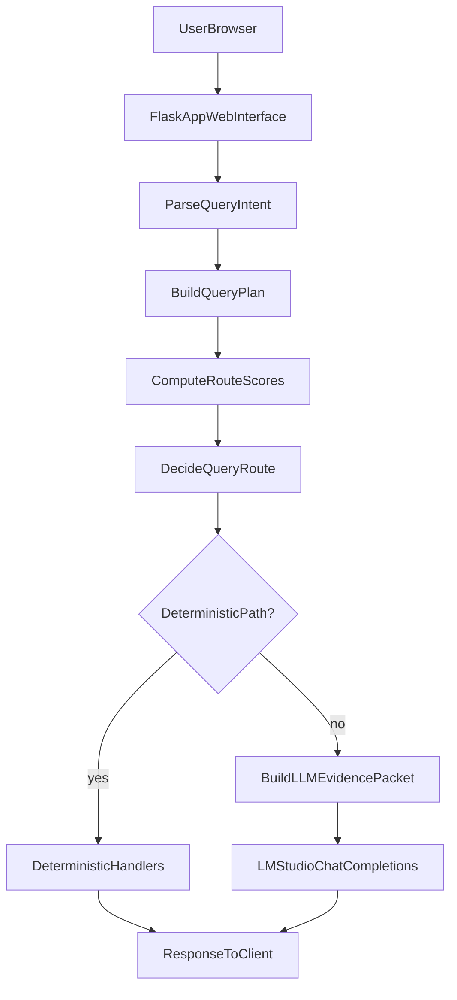

# 📋 EVI - Comprehensive Project Analysis

> **This document provides a complete technical deep-dive into the EVI project. For quick start and installation, see [README.md](README.md).**

---

## 📑 Table of Contents

1. [Project Overview](#-project-overview)
2. [Architecture & Design](#-architecture--design)
3. [Component Breakdown](#-component-breakdown)
4. [Data Flow & Processing](#-data-flow--processing)
5. [API Reference](#-api-reference)
6. [Database Schema](#-database-schema)
7. [Technology Stack](#-technology-stack)
8. [Key Features & Capabilities](#-key-features--capabilities)
9. [UFDR Data Structure](#-ufdr-data-structure)
10. [Query Engines](#-query-engines)
11. [AI Integration](#-ai-integration)
12. [Security & Authentication](#-security--authentication)
13. [Session & Case Management](#-session--case-management)
14. [File Upload & Processing](#-file-upload--processing)
15. [Response System](#-response-system)
16. [Frontend Architecture](#-frontend-architecture)
17. [Testing & Data](#-testing--data)
18. [Deployment & Configuration](#-deployment--configuration)
19. [Design Decisions](#-design-decisions)
20. [Future Enhancements](#-future-enhancements)
21. [Current Repository Inventory](#-current-repository-inventory)
22. [Module Catalog (Current)](#-module-catalog-current)
23. [Documentation Catalog (Current)](#-documentation-catalog-current)
24. [Operational Scripts and Release Readiness](#-operational-scripts-and-release-readiness)
25. [2026 Deep Technical Refresh (Authoritative)](#-2026-deep-technical-refresh-authoritative)

---

## 🎯 Project Overview

**EVI** (Evidence Investigation Scanner) is an AI-powered digital forensics tool designed for analyzing UFDR (Unified Forensic Data Records) files. Built for the Smart India Hackathon (SIH), it provides comprehensive forensic analysis capabilities through a modern web-based interface.

### Core Purpose
- Analyze digital forensic data from mobile devices
- Extract insights from UFDR files (JSON/ZIP formats)
- Provide natural language querying capabilities
- Generate comprehensive forensic reports
- Support multiple investigation scenarios

### Key Characteristics
- **Web-Based**: Flask-powered web application
- **AI-Enhanced**: Optional LM Studio integration for conversational AI
- **Modular Design**: Multiple query engines for different analysis approaches
- **Case Management**: Organize multiple forensic cases
- **Session Persistence**: Save and restore analysis sessions
- **PDF Export**: Generate comprehensive reports

---

## 🏗️ Architecture & Design

### High-Level Architecture

```
┌─────────────────────────────────────────────────────────────┐
│                    User Browser (Frontend)                   │
│  - HTML5/CSS3/JavaScript                                    │
│  - Bootstrap 5.3.0                                          │
│  - Font Awesome Icons                                        │
└──────────────────────┬──────────────────────────────────────┘
                       │ HTTP/HTTPS
                       │ REST API
┌──────────────────────▼──────────────────────────────────────┐
│              Flask Web Server (web_interface.py)             │
│  - Route Handlers                                           │
│  - Request Processing                                       │
│  - Session Management                                       │
│  - Authentication                                           │
└──────┬──────────────┬──────────────┬───────────────────────┘
       │              │              │
       ▼              ▼              ▼
┌─────────────┐ ┌─────────────┐ ┌─────────────┐
│   Core      │ │  Query      │ │   AI        │
│  Engines    │ │  Engines    │ │ Integration │
└─────────────┘ └─────────────┘ └─────────────┘
       │              │              │
       └──────────────┴──────────────┘
                       │
              ┌────────▼────────┐
              │   UFDR Data     │
              │   (Normalized)   │
              └─────────────────┘
```

### Design Patterns

1. **MVC Pattern**: Model (database), View (templates), Controller (routes)
2. **Modular Engines**: Swappable query engines for different workloads
3. **Adapter Pattern**: Normalizes different UFDR formats into unified schema
4. **Strategy Pattern**: Multiple query strategies (NL, Enhanced NL, RAG, AI)
5. **Singleton Pattern**: Global instances for engines and analyzers

---

## 🔧 Component Breakdown

### 1. Main Application (`FORENSIC/web_interface.py`)

**Size**: 7,500+ lines  
**Purpose**: Central Flask application handling all HTTP requests

#### Key Responsibilities:
- HTTP route handling (73 routes)
- File upload and processing
- Session management
- Authentication and authorization
- User profile management
- Profile picture upload and persistence
- AI chat integration
- PDF report generation
- Real-time streaming responses
- Cross-session context continuity
- Chat history persistence with metadata

#### Major Sections:
- **Configuration** (Lines 1-250)
  - Flask app initialization
  - Environment variables
  - LLM/LM Studio configuration
  - Database connections
  - Security settings
  - Import statements for engines, utils, core modules

- **Authentication** (Lines 1358-1600)
  - Unified `/auth` route (login/signup tabs)
  - `/login` route (redirects to `/auth`)
  - `/signup` route
  - `/logout` route
  - Session management
  - Development mode bypass
  - CAPTCHA integration
  - Profile data loading on login

- **Profile Management** (Lines 1317-1371)
  - `load_user_profile_data()` helper function
  - Profile data persistence across server restarts
  - Database column existence checking
  - Session data synchronization
  - Profile picture path management

- **File Upload** (Lines 2296-3060)
  - UFDR JSON/ZIP upload
  - File validation
  - ZIP extraction using HybridZipParser
  - Data normalization
  - File management endpoints

- **Query Processing** (Lines 3253-3625)
  - Natural language queries
  - Enhanced NL queries
  - Simplified queries
  - Comprehensive queries
  - AI retrieval
  - RAG-based answers
  - Smart analysis

- **AI Chat** (Lines 4741-5330)
  - Streaming chat endpoint (`/api/chat/stream`)
  - Non-streaming chat endpoint (`/api/chat`)
  - Adaptive prompt generation
  - Response formatting
  - Hallucination prevention (temperature control, prompt engineering)
  - Cursor tracking in streaming responses
  - Chat history persistence with metadata
  - Cross-session context loading

- **Case Management** (Lines 4141-4456)
  - Case CRUD operations
  - Case-session linking
  - Case statistics
  - User-filtered case access

- **Session Management** (Lines 4134-4300)
  - Session creation/retrieval
  - Chat history persistence with metadata
  - Query history tracking
  - Session preferences
  - Cross-session context loading
  - Related session history merging
  - Follow-up question detection

- **PDF Export** (Lines 6151-6726)
  - Report generation
  - Evidence compilation
  - Professional formatting
  - Comprehensive case reports

### 2. Enhanced Data Extractor (`FORENSIC/core/enhanced_data_extractor.py`)

**Purpose**: Extracts specific UFDR details for AI/LLM consumption

#### Features:
- Token-efficient data extraction
- Query-specific data filtering
- Formatting for LLM input
- Respects token constraints
- Shows actual names, messages, call details
- Increased limits: 200 items per type, 10,000 characters for text length
- Optimized for comprehensive data extraction

### 3. Semantic Data Extractor (`FORENSIC/core/semantic_data_extractor.py`)


#### Features:
- Query-aware semantic extraction
- Uses RAG engine for intelligent retrieval
- Extracts all relevant data chunks (no arbitrary limits)
- Similarity threshold-based filtering
- Complete, untruncated chunks for LLM consumption
- Comprehensive data index for fast lookup
- Falls back to keyword-based extraction if RAG unavailable
- Ensures complete context preservation

### 4. Hybrid ZIP Parser (`FORENSIC/core/hybrid_zip_parser.py`)

**Purpose**: Intelligent ZIP file parser with heuristic classification and LLM fallback

#### Features:
- Fast heuristic classification (90% of cases)
- LLM fallback for edge cases (10% of cases)
- Rule-based field transformation (no LLM)
- Pattern caching for learned structures
- Automatic UFDR format detection
- Handles various ZIP structures (Artifacts/, __metadata__/, Media/, Reports/)
- Normalizes different UFDR formats into unified schema

**Architecture**:
- Classification: Heuristics → Content Sampling → LLM (only if needed)
- Parsing: Rule-based field transformations (no LLM)
- Learning: Cache LLM insights to improve heuristics

### 5. Intelligent Analyzer (`FORENSIC/core/intelligent_analyzer.py`)

**Purpose**: General-purpose analysis framework with automatic query intent detection

#### Features:
- Automatic query intent detection
- Structured analysis data generation
- Ranking, statistics, patterns, and relationships analysis
- No hardcoded query patterns required
- Analysis caching for performance
- Multi-entity analysis support

**Analysis Types**:
- Ranking analysis (top, most, key contacts/messages)
- Statistical analysis (counts, frequencies, distributions)
- Pattern detection (communication patterns, temporal patterns)
- Relationship mapping (contact networks, communication graphs)

### 6. Query Engines (`FORENSIC/engines/`)

#### 6.1 Natural Language Query Engine (`nl_query_engine.py`)

**Purpose**: Basic keyword-based query processing

**Features**:
- Basic keyword matching
- Pattern recognition
- Simple query processing
- Suspicious keyword detection
- Money-related keyword detection

#### 6.2 Enhanced NL Query Engine (`enhanced_nl_query_engine.py`)

**Purpose**: Advanced pattern matching and entity extraction

**Features**:
- Advanced pattern matching
- Entity extraction
- Improved relevance scoring
- Context-aware query processing
- Multi-entity relationship detection

#### 6.3 Simplified NL Query Engine (`simplified_nl_query_engine.py`)

**Purpose**: Lightweight, fast query processing

**Features**:
- Lightweight engine
- Fast processing
- Simple queries
- Minimal resource usage
- Quick response times

#### 6.4 AI Retrieval Engine (`ai_ufdr_retrieval_engine.py`)

**Purpose**: AI-powered semantic retrieval

**Features**:
- AI-powered retrieval
- Embedding-based search
- Semantic matching
- Context-aware results
- Intelligent ranking

#### 6.5 RAG Engine (`rag_engine.py`)

**Purpose**: Retrieval-Augmented Generation for context-aware responses

**Status**: Currently disabled - system uses keyword-based extraction instead

**Features** (when enabled):
- Sentence Transformers embeddings (`all-MiniLM-L6-v2`)
- FAISS vector similarity search
- Top-k relevant chunk retrieval (default k=6)
- Builds embedding index over:
  - Messages (SMS, WhatsApp, iMessage)
  - Contacts
  - Call logs
  - Files
  - Device info
- Metadata preservation for citations
- Query performance caching
- Semantic similarity matching
- Index rebuilding capability
- Batch processing support

**Note**: RAG engine is disabled by default. The system uses keyword-based semantic extraction which provides similar functionality without requiring additional dependencies (sentence-transformers, faiss-cpu).

#### 6.6 Smart Analyzer (`smart_analyzer.py`)

**Purpose**: Intelligent analysis and insights generation

**Features**:
- Pattern detection (communication patterns, suspicious activity)
- Timeline analysis and reconstruction
- Communication analysis (frequency, timing, relationships)
- Relationship mapping between contacts
- File analysis and metadata extraction
- Suspicious activity detection
- Dynamic exploration data generation
- Interactive data exploration support
- Multi-dimensional analysis

**Analysis Types**:
- Communication pattern analysis
- Temporal pattern detection
- Relationship network mapping
- Anomaly identification
- Activity timeline reconstruction
- Statistical summaries

### 7. Utility Modules (`FORENSIC/utils/`)

#### 7.1 Query Analyzer (`query_analyzer.py`)
**Purpose**: Detects query complexity and intent

**Features**:
- Complexity detection (simple/medium/complex)
- Intent classification
- Data type detection
- Response style determination
- Follow-up question detection

**Complexity Levels**:
- **Simple**: Direct factual questions (counts, lists)
- **Medium**: Summary with evidence
- **Complex**: Full analysis required

#### 7.2 Adaptive Prompt Generator (`adaptive_prompts.py`)

**Purpose**: Generates adaptive prompts based on query analysis

**Features**:
- Tailors prompts to query complexity
- Adjusts prompt structure based on available data
- Optimizes prompts for different query types
- Integrates with query analyzer for intelligent construction
- Handles simple, medium, and complex queries differently

**Response Styles**:
- **Direct**: Simple, factual answers
- **Summary with Evidence**: Concise summary + key evidence
- **Full Analysis**: Comprehensive forensic analysis

**Prompt Optimization**:
- Simple queries: Minimal context, direct answers
- Medium queries: Relevant evidence, concise summaries
- Complex queries: Full context, comprehensive analysis

#### 7.3 Confidence Calculator (`confidence.py`)
**Purpose**: Calculates confidence scores for AI responses

**Factors**:
- Retrieval similarity scores
- Intent detection strength
- Data completeness
- Query complexity
- Response quality

**Score Range**: 0.0 to 1.0

#### 7.4 Image Citation Extractor (`image_citation.py`)
**Purpose**: Extracts relevant image citations from UFDR data
**Status**: Currently disabled (image detection not implemented)

### 8. Session & Case Management (`FORENSIC/database/code/session_db.py`)

**Purpose**: SQLite database module for persistence

#### Database Tables:

1. **cases**
   - `case_id` (TEXT PRIMARY KEY)
   - `case_name` (TEXT)
   - `status` (TEXT: Active/Closed/Archived)
   - `evidence_device` (TEXT)
   - `created_at` (TIMESTAMP)
   - `updated_at` (TIMESTAMP)
   - `created_by` (TEXT)
   - `description` (TEXT)
   - `metadata` (TEXT JSON)

2. **sessions**
   - `session_id` (TEXT PRIMARY KEY)
   - `case_id` (TEXT FOREIGN KEY)
   - `user_id` (INTEGER)
   - `title` (TEXT)
   - `created_at` (TIMESTAMP)
   - `last_accessed` (TIMESTAMP)
   - `is_active` (INTEGER)
   - `metadata` (TEXT JSON)

3. **chat_history**
   - `id` (INTEGER PRIMARY KEY)
   - `session_id` (TEXT FOREIGN KEY)
   - `role` (TEXT: user/assistant)
   - `content` (TEXT)
   - `timestamp` (TIMESTAMP)
   - `metadata` (TEXT JSON)

4. **queries**
   - `id` (INTEGER PRIMARY KEY)
   - `session_id` (TEXT FOREIGN KEY)
   - `query_text` (TEXT)
   - `response` (TEXT)
   - `timestamp` (TIMESTAMP)
   - `metadata` (TEXT JSON)

5. **preferences**
   - `id` (INTEGER PRIMARY KEY)
   - `session_id` (TEXT FOREIGN KEY)
   - `key` (TEXT)
   - `value` (TEXT)
   - `updated_at` (TIMESTAMP)

6. **session_files**
   - `id` (INTEGER PRIMARY KEY)
   - `session_id` (TEXT FOREIGN KEY)
   - `filename` (TEXT)
   - `file_path` (TEXT)
   - `uploaded_at` (TIMESTAMP)
   - `metadata` (TEXT JSON)

### 9. Security Enhancements (`FORENSIC/security/security_enhancements.py`)

**Purpose**: Comprehensive security features for forensic data protection

#### 9.1 Data Encryption (`DataEncryption`)

**Purpose**: Field-level and file encryption using AES-256 Fernet

**Features**:
- AES-256 Fernet encryption for sensitive data
- Field-level encryption for database fields
- File encryption for stored files
- Automatic key management
- Secure key storage and retrieval

**Use Cases**:
- Encrypt sensitive case data
- Protect stored UFDR files
- Secure audit logs
- Encrypt user session data

#### 9.2 Audit Logging (`AuditLogger`)

**Purpose**: Comprehensive tracking of security-relevant actions

**Features**:
- Tracks all security-relevant actions
- Records file hashes for integrity verification
- Logs IP addresses and timestamps
- Maintains chain of custody
- Stores audit logs securely
- Supports forensic investigation compliance

**Logged Actions**:
- User authentication (login/logout)
- File uploads and downloads
- Case creation/modification/deletion
- Session access and modifications
- Data access and queries
- Security policy changes

**Audit Log Format**:
- Timestamp
- User ID
- Action type
- Resource accessed
- IP address
- File hash (if applicable)
- Success/failure status

#### 9.3 Role-Based Access Control (`RBAC`)

**Purpose**: Manage user permissions based on roles

**Roles**:
- **Admin**: Full system access, user management, security configuration
- **Investigator**: Case creation, data analysis, report generation
- **Viewer**: Read-only access to cases and reports
- **Auditor**: Access to audit logs and compliance reports

**Features**:
- Role-based permission decorators
- Route-level access control
- Function-level permission checks
- Dynamic role assignment
- Permission inheritance

**Permission Decorators**:
- `@require_role(role)` - Require specific role
- `@require_any_role(roles)` - Require any of listed roles
- `@require_permission(permission)` - Require specific permission

**Additional Security Features**:
- Input validation and sanitization
- XSS prevention
- SQL injection prevention
- File upload validation
- Secure session management
- CAPTCHA for authentication
- Secure password requirements

### 10. Authentication System (`Authentication/`)

**Purpose**: User authentication and authorization

#### Components:
- **app.py**: Standalone authentication server (optional)
- **evi_scan.db**: SQLite database for user accounts
- **setup_database.py**: Database initialization
- **templates/**: Authentication UI templates
  - `forensic_auth.html`: Login page
  - `signup.html`: Registration page
  - `privacy.html`: Privacy policy
  - `terms.html`: Terms of service

#### Features:
- bcrypt password hashing
- Session-based authentication
- Secure session cookies
- CAPTCHA for login and signup
- Development mode (`DEV_MODE`) bypass
- User account management
- Password strength requirements
- Email validation
- User profile management (name, email, phone, location, bio, profile picture)
- Profile picture upload and persistence
- Cross-page profile picture synchronization

---

## 🔄 Data Flow & Processing

### Upload Flow

```
User uploads UFDR file (JSON/ZIP)
         │
         ▼
web_interface.py receives file
         │
         ├─→ ZIP File?
         │   │
         │   ├─→ Hybrid ZIP Parser
         │   │   │
         │   │   ├─→ Heuristic classification (90% cases)
         │   │   ├─→ LLM fallback (10% edge cases)
         │   │   ├─→ Extract Artifacts/
         │   │   ├─→ Extract __metadata__/
         │   │   ├─→ Extract Media/
         │   │   └─→ Extract Reports/
         │   │
         │   └─→ Normalize to UFDR schema
         │
         └─→ JSON File?
             │
             └─→ Parse JSON
                 │
                 └─→ Normalize to UFDR schema
                     │
                     ▼
         Store in ACTIVE_DATA
         Store in data/uploaded_ufdrs/
         Link to session/case
```

### Query Processing Flow

```
User submits query
         │
         ▼
Query Analyzer (query_analyzer.py)
         │
         ├─→ Detect complexity
         ├─→ Detect intent
         ├─→ Detect data types
         └─→ Determine response style
         │
         ▼
Adaptive Prompt Generator (adaptive_prompts.py)
         │
         ├─→ Generate prompt based on:
         │   ├─→ Query complexity
         │   ├─→ Response style
         │   ├─→ Data context
         │   └─→ Chat history
         │
         ▼
Data Extraction
         │
         ├─→ Enhanced Data Extractor (token-efficient)
         ├─→ Semantic Data Extractor (RAG-based, query-aware)
         ├─→ Filter by query intent
         ├─→ Format for LLM
         └─→ Respect token limits
         │
         ▼
Query Engine Selection
         │
         ├─→ Simple query → NL Engine / Simplified NL Engine
         ├─→ Medium query → Enhanced NL Engine
         ├─→ Complex query → RAG Engine / AI Retrieval / Smart Analyzer
         └─→ AI Chat → LM Studio (with hallucination prevention)
         │
         ▼
Response Generation
         │
         ├─→ Format response
         ├─→ Add evidence citations
         ├─→ Calculate confidence score
         └─→ Stream or return complete
         │
         ▼
Store in chat history
Update session access time
Return to user
```

### AI Chat Flow (Streaming)

```
User sends chat message
         │
         ▼
/api/chat/stream endpoint
         │
         ├─→ Validate session
         ├─→ Get chat history (current + related sessions)
         ├─→ Detect follow-up questions
         ├─→ Analyze query complexity
         └─→ Extract relevant data
         │
         ▼
Generate adaptive prompt
         │
         ├─→ Query complexity → Response style
         ├─→ Data context → Relevant evidence
         ├─→ Chat history → Context awareness
         └─→ Follow-up detection → Context notes
         │
         ▼
LM Studio API Call
         │
         ├─→ POST /v1/chat/completions
         ├─→ Stream: true
         ├─→ Model: Qwen/Qwen2.5-7B-Instruct
         └─→ Messages: system + history + user
         │
         ▼
Stream response chunks
         │
         ├─→ Yield each chunk with cursor tracking
         ├─→ Update UI in real-time
         ├─→ Track cursor position
         └─→ Finalize message
         │
         ▼
Store in chat history (with metadata)
         ├─→ Save to in-memory CHAT_HISTORIES
         ├─→ Persist to database (session_db)
         ├─→ Include metadata (confidence, model, timestamp)
         └─→ Update session last_accessed
         │
         ▼
Calculate confidence
Return metadata
```

---

## 🌐 API Reference

### Authentication Routes

| Route | Method | Purpose | Auth Required |
|-------|--------|---------|---------------|
| `/auth` | GET, POST | Unified authentication page (login/signup tabs) | No |
| `/login` | GET, POST | User login (redirects to `/auth`) | No |
| `/signup` | GET, POST | User registration | No |
| `/logout` | GET | User logout | Yes |

### Profile Management Routes

| Route | Method | Purpose | Auth Required |
|-------|--------|---------|---------------|
| `/profile` | GET | Profile page | Yes |
| `/api/profile/update` | POST | Update profile information | Yes |
| `/api/profile/upload-picture` | POST | Upload profile picture | Yes |
| `/api/profile/stats` | GET | Get user statistics | Yes |
| `/api/profile/security` | GET, POST | Get/update security information | Yes |
| `/api/profile/change-password` | POST | Change user password | Yes |

### Main Routes

| Route | Method | Purpose | Auth Required |
|-------|--------|---------|---------------|
| `/` | GET | Case Manager dashboard | Yes* |
| `/case-manager` | GET | Case Manager dashboard (alias) | Yes* |
| `/evi-scan` | GET | Main analysis interface | Yes* |
| `/images` | GET | Images gallery | Yes* |
| `/audit-logs` | GET | Audit logs viewer (security) | Yes* |

*Development mode (`DEV_MODE=True`) bypasses authentication

### File Upload Routes

| Route | Method | Purpose |
|-------|--------|---------|
| `/api/upload` | GET, POST | Upload UFDR file (JSON/ZIP) |
| `/api/uploaded-files` | GET | List uploaded files |
| `/api/clear-uploads` | POST | Clear all uploads |
| `/api/remove-upload/<filename>` | DELETE | Remove specific file |

### Query Routes

| Route | Method | Purpose |
|-------|--------|---------|
| `/api/nl-query` | POST | Natural language query |
| `/api/enhanced-suggestions` | GET | Get query suggestions |
| `/api/comprehensive-analysis` | GET | Comprehensive analysis |
| `/api/simplified-query` | POST | Simplified query |
| `/api/simplified-analysis` | GET | Simplified analysis |
| `/api/comprehensive-query` | POST | Comprehensive query |
| `/api/comprehensive-analysis` | GET | Comprehensive analysis |
| `/api/ai-retrieval` | POST | AI-powered retrieval |
| `/api/rag-answer` | POST | RAG-based answer |
| `/api/rag-reindex` | POST | Rebuild RAG index |
| `/api/smart-analysis` | POST | Smart analyzer |

### AI Chat Routes

| Route | Method | Purpose |
|-------|--------|---------|
| `/api/chat/stream` | POST | Streaming AI chat |
| `/api/chat` | POST | Non-streaming AI chat |
| `/api/chat/clear` | POST | Clear chat history |
| `/api/explore-data` | GET | Get all messages, contacts, calls, and files for Dynamic Smart Analysis |

### Case Management Routes

| Route | Method | Purpose |
|-------|--------|---------|
| `/api/cases` | GET | List all cases |
| `/api/cases` | POST | Create new case |
| `/api/cases/<case_id>` | GET | Get case details |
| `/api/cases/<case_id>` | PUT | Update case |
| `/api/cases/<case_id>` | DELETE | Delete case |
| `/api/cases/<case_id>/create-session` | POST | Create session for case |

### Session Management Routes

| Route | Method | Purpose |
|-------|--------|---------|
| `/api/sessions` | GET | List all sessions (user-filtered) |
| `/api/sessions` | POST | Create new session |
| `/api/sessions/<session_id>` | GET | Get session details |
| `/api/sessions/<session_id>/preferences` | GET, POST | Get/set preferences |

### Analysis Routes

| Route | Method | Purpose |
|-------|--------|---------|
| `/api/stats` | GET | Get statistics |
| `/api/ai-analysis` | GET | AI analysis |
| `/api/ai-analysis/<filename>` | GET | AI analysis for file |
| `/api/quick-commands` | GET | Quick commands |

### Model & Configuration Routes

| Route | Method | Purpose |
|-------|--------|---------|
| `/api/models` | GET | List available models |
| `/api/models/<model_id>` | POST | Switch model |
| `/api/llm-models` | GET | List LLM models |
| `/api/llm-switch` | POST | Switch LLM model |
| `/api/lm-studio/status` | GET | LM Studio status |
| `/api/qwen-vl/status` | GET | Qwen2.5-VL status |

### Export Routes

| Route | Method | Purpose |
|-------|--------|---------|
| `/api/export/pdf` | POST | Generate PDF report |


### Utility Routes

| Route | Method | Purpose |
|-------|--------|---------|
| `/api/health` | GET | Health check |
| `/api/device-metadata` | POST | Get device metadata |
| `/api/owner-info` | GET | Get owner information |
| `/api/rag-reindex` | POST | Rebuild RAG index |
| `/api/debug/active-data` | GET | Debug active data (requires auth) |

### Media & Static Routes

| Route | Method | Purpose |
|-------|--------|---------|
| `/api/media/<path:filename>` | GET | Serve media files from ZIP archives |
| `/chimes/<filename>` | GET | Serve chime/audio files |

---

## 💾 Database Schema

### Cases Table

```sql
CREATE TABLE cases (
    case_id TEXT PRIMARY KEY,
    case_name TEXT NOT NULL,
    status TEXT DEFAULT 'Active',
    evidence_device TEXT,
    created_at TIMESTAMP DEFAULT CURRENT_TIMESTAMP,
    updated_at TIMESTAMP DEFAULT CURRENT_TIMESTAMP,
    created_by TEXT,
    description TEXT,
    metadata TEXT
);
```

**Status Values**: `Active`, `Closed`, `Archived`

### Sessions Table

```sql
CREATE TABLE sessions (
    session_id TEXT PRIMARY KEY,
    case_id TEXT,
    user_id INTEGER,
    title TEXT,
    created_at TIMESTAMP DEFAULT CURRENT_TIMESTAMP,
    last_accessed TIMESTAMP DEFAULT CURRENT_TIMESTAMP,
    is_active INTEGER DEFAULT 1,
    metadata TEXT
);
```

### Chat History Table

```sql
CREATE TABLE chat_history (
    id INTEGER PRIMARY KEY AUTOINCREMENT,
    session_id TEXT NOT NULL,
    role TEXT NOT NULL,
    content TEXT NOT NULL,
    timestamp TIMESTAMP DEFAULT CURRENT_TIMESTAMP,
    metadata TEXT,
    FOREIGN KEY (session_id) REFERENCES sessions(session_id) ON DELETE CASCADE
);
```

**Role Values**: `user`, `assistant`

### Queries Table

```sql
CREATE TABLE queries (
    id INTEGER PRIMARY KEY AUTOINCREMENT,
    session_id TEXT NOT NULL,
    query_text TEXT NOT NULL,
    response TEXT,
    timestamp TIMESTAMP DEFAULT CURRENT_TIMESTAMP,
    metadata TEXT,
    FOREIGN KEY (session_id) REFERENCES sessions(session_id) ON DELETE CASCADE
);
```

### Preferences Table

```sql
CREATE TABLE preferences (
    id INTEGER PRIMARY KEY AUTOINCREMENT,
    session_id TEXT NOT NULL,
    key TEXT NOT NULL,
    value TEXT,
    updated_at TIMESTAMP DEFAULT CURRENT_TIMESTAMP,
    FOREIGN KEY (session_id) REFERENCES sessions(session_id) ON DELETE CASCADE,
    UNIQUE(session_id, key)
);
```

### Session Files Table

```sql
CREATE TABLE session_files (
    id INTEGER PRIMARY KEY AUTOINCREMENT,
    session_id TEXT NOT NULL,
    filename TEXT NOT NULL,
    file_path TEXT NOT NULL,
    uploaded_at TIMESTAMP DEFAULT CURRENT_TIMESTAMP,
    metadata TEXT,
    FOREIGN KEY (session_id) REFERENCES sessions(session_id) ON DELETE CASCADE
);
```

### Authentication Database (`Authentication/evi_scan.db`)

```sql
CREATE TABLE users (
    id INTEGER PRIMARY KEY AUTOINCREMENT,
    email TEXT UNIQUE NOT NULL,
    password_hash TEXT NOT NULL,
    role TEXT DEFAULT 'Viewer',
    created_at TIMESTAMP DEFAULT CURRENT_TIMESTAMP,
    first_name TEXT,
    last_name TEXT,
    username TEXT,
    phone TEXT,
    location TEXT,
    bio TEXT,
    profile_picture TEXT
);

CREATE TABLE login_logs (
    id INTEGER PRIMARY KEY AUTOINCREMENT,
    user_id INTEGER,
    login_time TIMESTAMP DEFAULT CURRENT_TIMESTAMP,
    ip_address TEXT,
    FOREIGN KEY (user_id) REFERENCES users(id)
);
```

**Role Values**: `Admin`, `Investigator`, `Viewer`, `Auditor` (default: `Viewer`)

**Profile Fields**:
- `first_name`, `last_name`: User's full name
- `username`: Display username
- `phone`: Contact phone number
- `location`: User location
- `bio`: User biography/description
- `profile_picture`: Path to profile picture image (stored in `static/profile_pictures/`)

---

## 🛠️ Technology Stack

### Backend

| Technology | Version | Purpose |
|------------|---------|---------|
| Python | 3.7+ | Core language |
| Flask | 2.3.3 | Web framework |
| SQLite3 | Built-in | Database |
| bcrypt | 4.0.1 | Password hashing |
| ReportLab | >=4.0.7 | PDF generation |

### Data Processing

| Technology | Version | Purpose |
|------------|---------|---------|
| Pandas | 2.1.3 | Data manipulation |
| RapidFuzz | 3.9.7 | Fuzzy string matching |
| ORJSON | Minimal profile dependency (unversioned) | Fast JSON processing |

### AI/ML (Optional)

| Technology | Version | Purpose |
|------------|---------|---------|
| LM Studio | Latest | Local LLM server |
| Transformers | 4.35.2 | Hugging Face models (compatible with PyTorch 2.1+) |
| PyTorch | >=2.1.0 | Deep learning framework |
| Accelerate | 1.12.0 | Model optimization |
| Tokenizers | >=0.14,<0.19 | Fast tokenization |
| BitsAndBytes | 0.41.3 | Quantization support |

### Frontend

| Technology | Version | Purpose |
|------------|---------|---------|
| HTML5 | - | Markup |
| CSS3 | - | Styling |
| JavaScript | ES6+ | Interactivity |
| Bootstrap | 5.3.0 | UI framework |
| Font Awesome | 6.4.0 | Icons |

---

## ✨ Key Features & Capabilities

### Core Forensic Analysis

1. **Scenario Detection**
   - Kidnapping Conspiracy detection
   - Human Trafficking identification
   - Cyber Fraud Phishing detection
   - Extensible to any case type

2. **Natural Language Queries**
   - Plain English querying
   - Keyword recognition
   - Pattern matching
   - Entity recognition

3. **Data Analysis**
   - Contact analysis
   - Message analysis (SMS, WhatsApp, iMessage)
   - Call log analysis
   - Timeline reconstruction
   - Relationship mapping

4. **File Support**
   - UFDR JSON files
   - UFDR ZIP archives
   - Automatic extraction
   - Media file handling

### AI-Powered Features

1. **AI Chat Assistant**
   - Conversational interface
   - Context-aware responses
   - Streaming responses with cursor tracking
   - Chat history persistence with metadata
   - Cross-session context continuity
   - Follow-up question detection
   - Enhanced follow-up indicators ("tell me more", "expand", pronouns)

2. **Adaptive Response System**
   - Query complexity detection
   - Response style adaptation
   - Direct/Summary/Full Analysis modes

3. **Semantic Search**
   - Keyword-based semantic extraction
   - Intelligent data extraction
   - Query-aware semantic extraction
   - Context-aware truncation to fit model limits

4. **Enhanced Analysis**
   - AI-generated summaries
   - Pattern detection
   - Anomaly identification
   - Hallucination prevention (temperature control, prompt engineering)
   - Response quality indicators

5. **Dynamic Smart Analysis**
   - Interactive data exploration
   - Clickable messages, contacts, and calls
   - Auto-insert into chat for follow-up questions
   - Tabbed interface (Contacts, Call Logs, Messages)
   - Real-time data loading

### Web Interface Features

1. **Case Management**
   - Create/edit/delete cases
   - Case status tracking
   - Case-based organization

2. **Session Persistence**
   - Save analysis sessions
   - Restore chat history with full metadata
   - Query history tracking
   - Cross-session context loading (related sessions in same case)
   - Automatic history merging from related sessions
   - Session preferences persistence

3. **PDF Export**
   - Comprehensive reports
   - Evidence compilation
   - Professional formatting

4. **Authentication & User Management**
   - Unified login/signup page
   - Secure session management
   - CAPTCHA protection
   - Role-based access control
   - Development mode bypass
   - User profile management
   - Profile picture upload and persistence
   - Password change functionality
   - Account security settings

5. **Security Features**
   - Data encryption (AES-256 Fernet)
   - Comprehensive audit logging
   - Chain of custody tracking
   - File hash verification
   - Role-based permissions

---

## 📂 UFDR Data Structure

### ZIP-Based UFDR Structure

```
UFDR_FILE.zip
├── Artifacts/
│   ├── Calls/
│   │   └── calls.json
│   ├── Contacts/
│   │   └── contacts.json
│   ├── SMS/
│   │   └── sms.json
│   └── WhatsApp/
│       └── whatsapp.json
├── __metadata__/
│   ├── case_info.json
│   └── device_info.json
├── Media/
│   ├── Images/
│   │   └── *.jpg, *.png
│   └── Videos/
│       └── *.mp4
└── Reports/
    └── summary.json
```

### Normalized In-Memory Schema

```python
{
    "<filename>.json": {
        "devices": [
            {
                "device_info": {
                    "owner": "...",
                    "model": "...",
                    "imei": "...",
                    "serial_number": "..."
                },
                "case_info": {
                    "case_id": "...",
                    "case_name": "...",
                    "investigator": "..."
                },
                "contacts": [
                    {
                        "name": "...",
                        "phone": "...",
                        "email": "...",
                        "metadata": {...}
                    }
                ],
                "messages": [
                    {
                        "from": "...",
                        "to": "...",
                        "text": "...",
                        "timestamp": "...",
                        "source": "SMS|WhatsApp|iMessage"
                    }
                ],
                "call_logs": [
                    {
                        "from": "...",
                        "to": "...",
                        "timestamp": "...",
                        "duration": "...",
                        "call_type": "incoming|outgoing|missed"
                    }
                ],
                "files": [...],
                "media": {
                    "images": [...],
                    "videos": [...]
                }
            }
        ],
        "tampered": bool
    },
    "_zip_info": {
        "is_zip": True/False,
        "extracted_path": "<temp path>",
        "images": [...],
        "videos": [...],
        "json_files": [...]
    }
}
```

---

## 🔍 Query Engines

### Engine Selection Logic

```
Query Complexity Detection
         │
         ├─→ Simple
         │   └─→ NL Query Engine
         │
         ├─→ Medium
         │   └─→ Enhanced NL Engine
         │
         └─→ Complex
             ├─→ RAG Engine (if embeddings available)
             ├─→ AI Retrieval Engine
             └─→ Smart Analyzer
```

### Engine Comparison

| Engine | Use Case | Speed | Accuracy | AI Required |
|--------|----------|-------|----------|-------------|
| NL Query Engine | Simple queries | Fast | Medium | No |
| Enhanced NL Engine | Pattern matching | Medium | High | No |
| Simplified NL Engine | Quick queries | Very Fast | Medium | No |
| Comprehensive NL Engine | Full analysis | Slow | High | No |
| AI Retrieval Engine | Semantic search | Medium | Very High | Yes |
| RAG Engine | Context-aware | Medium | Very High | Yes |
| Smart Analyzer | Insights | Slow | High | Optional |

---

## 🤖 AI Integration

### LM Studio Configuration

- **Model**: `Qwen/Qwen2.5-7B-Instruct`
- **API Endpoint**: `http://localhost:1234/v1/chat/completions`
- **API Format**: OpenAI-compatible
- **Streaming**: Supported
- **Context Window**: 32768 tokens (effective context may be capped by runtime model `n_ctx`)
- **Context Management**: Automatic truncation to fit within model limits

### Adaptive Prompt System

1. **Query Analysis**
   - Complexity detection
   - Intent classification
   - Data type identification

2. **Prompt Generation**
   - Direct prompts (simple queries)
   - Summary prompts (medium queries)
   - Full analysis prompts (complex queries)

3. **Response Formatting**
   - Executive Summary
   - Evidence Discovered
   - Timeline Analysis
   - Relationship Mapping
   - Security Concerns
   - Pattern Analysis
   - Recommendations
   - Evidence Integrity

### Response Styles

#### Direct Response
- Simple, factual answers
- Direct quotes from data
- Minimal analysis

#### Summary with Evidence
- Brief overview (2-3 sentences)
- Top 5-10 evidence items
- Statistics if applicable

#### Full Analysis
- Comprehensive forensic analysis
- Multiple sections
- Detailed evidence citations
- Recommendations

---

## 🔒 Security & Authentication

### Authentication Modes

1. **Production Mode** (`DEV_MODE=False`)
   - Authentication required
   - Login/signup pages
   - Session-based auth
   - Password hashing with bcrypt

2. **Development Mode** (`DEV_MODE=True`)
   - Authentication bypassed
   - Direct access to Case Manager
   - For testing only

### Security Features

#### Authentication & Authorization
- Password hashing (bcrypt)
- Session-based authentication
- Secure session cookies
- CAPTCHA for login/signup
- Role-based access control (RBAC)
- Permission-based route protection

#### Data Protection
- AES-256 Fernet encryption for sensitive data
- Field-level encryption
- File encryption for stored files
- Secure key management
- Data integrity verification

#### Audit & Compliance
- Comprehensive audit logging
- Chain of custody tracking
- File hash verification
- IP address logging
- Action timestamping
- Compliance reporting

#### Input Security
- Input validation and sanitization
- XSS prevention
- SQL injection prevention
- File upload validation
- Secure file storage
- Path traversal prevention

---

## 👤 User Profile Management

### Profile Data Structure

User profiles include the following fields:
- **Basic Information**: First name, last name, username, email
- **Contact Information**: Phone number, location
- **Personal**: Bio/description
- **Visual**: Profile picture (uploaded image)

### Profile Picture Management

**Storage**:
- Profile pictures are stored in `FORENSIC/static/profile_pictures/`
- File naming: `user_{user_id}_{unique_hash}.png`
- Old profile pictures are automatically deleted when a new one is uploaded

**Persistence**:
- Profile data is stored in the `users` table in `evi_scan.db`
- Profile data is loaded into Flask session on login
- Profile data persists across server restarts
- Profile pictures are accessible via `/static/profile_pictures/{filename}`

**Cross-Page Synchronization**:
- Profile picture updates are reflected across all pages:
  - Case Manager header
  - Chat interface sidebar
  - Settings modal
- Updates happen in real-time via JavaScript
- Session data is automatically refreshed on page load

### Profile Data Loading

**Function**: `load_user_profile_data(user_id=None)`

**Purpose**: Loads user profile data from database and updates Flask session

**Features**:
- Checks which database columns exist before querying (handles missing columns gracefully)
- Only selects columns that exist in the database
- Updates session with all profile fields
- Handles missing optional fields (phone, location, bio, profile_picture)
- Logs profile picture loading for debugging
- Fallback mechanisms for missing data
- Direct database query as last resort

**Usage**:
- Called automatically on login
- Called when accessing Case Manager
- Called when accessing chat interface
- Called in `login_required` decorator (DEV_MODE)
- Ensures profile data persists across server restarts

### Profile API Endpoints

| Route | Method | Purpose |
|-------|--------|---------|
| `/api/profile/update` | POST | Update profile information (name, email, phone, location, bio) |
| `/api/profile/upload-picture` | POST | Upload and save profile picture |
| `/api/profile/stats` | GET | Get user statistics (active cases, recent activity) |
| `/api/profile/security` | GET | Get security information (active sessions, 2FA status) |

### Settings Integration

The Settings modal in Case Manager includes:
- **Edit Profile**: Update personal information
- **Change Password**: Update account password
- **Account Security**: View security settings
- **Recent Activity**: View recent case activity
- **Security**: Active sessions, Two-Factor Authentication
- **Preferences**: Theme, Language, Date Format
- **Notifications**: Email, Case Updates, Security Alerts
- **Privacy**: Profile Visibility, Activity Tracking, Data Deletion
- **Data**: Export user data
- **Account**: Delete account

### Database Migration

The system automatically adds profile columns to the `users` table if they don't exist:
- `phone` (TEXT)
- `location` (TEXT)
- `bio` (TEXT)
- `profile_picture` (TEXT)

This ensures backward compatibility with existing databases.

---

## 📊 Session & Case Management

### Case Lifecycle

```
Create Case
    │
    ├─→ Set metadata
    ├─→ Assign investigator
    └─→ Set status (Active)
         │
         ├─→ Upload UFDR files
         ├─→ Create sessions
         ├─→ Run analysis
         │
         └─→ Update status
              ├─→ Closed (investigation complete)
              └─→ Archived (long-term storage)
```

### Session Lifecycle

```
Create Session
    │
    ├─→ Link to case (optional)
    ├─→ Set title
    └─→ Initialize chat history
         │
         ├─→ Upload files
         ├─→ Run queries
         ├─→ Chat with AI
         │   ├─→ Store messages with metadata
         │   ├─→ Detect follow-up questions
         │   └─→ Include cross-session context
         │
         └─→ Save preferences
              │
              └─→ Restore later
                  ├─→ Load current session history
                  ├─→ Load related sessions (same case)
                  ├─→ Merge histories chronologically
                  └─→ Restore preferences
```

### Cross-Session Context Continuity

**Feature**: When restoring a session, the system automatically loads chat history from related sessions in the same case to provide full context continuity.

**How It Works**:
1. **Load Current Session**: Gets chat history from the session being restored
2. **Load Related Sessions**: Finds all other sessions with the same `case_id`
3. **Merge Histories**: Combines messages chronologically (up to 50 messages per related session)
4. **Context in Prompts**: All merged history is included in LLM prompts with source tracking

**Benefits**:
- Follow-up questions can reference conversations from previous sessions
- Full investigation context across multiple sessions
- Seamless continuation of analysis work

---

## 📤 File Upload & Processing

### Supported Formats

1. **UFDR JSON**
   - Single JSON file
   - Normalized structure
   - Direct processing

2. **UFDR ZIP**
   - ZIP archive
   - Extracted automatically
   - Normalized to schema

### Upload Process

1. File validation
2. Size check (50MB max)
3. Format validation
4. ZIP extraction (if needed)
5. Data normalization
6. Storage in `data/uploaded_ufdrs/`
7. Link to session/case

### File Storage

- **Uploaded Files**: `FORENSIC/data/uploaded_ufdrs/`
- **Temporary Files**: `FORENSIC/data/uploads/` (auto-cleaned)
- **Test Data**: `FORENSIC/data/UFDR's(new)/` (ZIP UFDR files)

---

## 📝 Response System

### Adaptive Response Generation

```
User Query
    │
    ▼
Query Analyzer
    ├─→ Complexity: simple/medium/complex
    ├─→ Intent: contact/message/call/timeline/...
    └─→ Data Types: contacts/messages/calls
    │
    ▼
Response Style Selection
    ├─→ Simple → Direct Response
    ├─→ Medium → Summary with Evidence
    └─→ Complex → Full Analysis
    │
    ▼
Prompt Generation
    ├─→ System prompt (forensic analyst role)
    ├─→ Data context (extracted UFDR data)
    ├─→ User query
    └─→ Chat history (if available)
    │
    ▼
LLM Processing
    ├─→ LM Studio API call
    ├─→ Streaming response
    └─→ Response formatting
    │
    ▼
Post-Processing
    ├─→ Hallucination prevention (temperature control, prompt engineering)
    ├─→ Confidence calculation
    ├─→ Evidence citations
    └─→ Formatting
    │
    ▼
Response to User (with quality indicators)
```

---

## 🎨 Frontend Architecture

### Main Templates

1. **enhanced_index.html**
   - Main dashboard
   - File upload interface
   - Query interface
   - AI chat interface
   - Results display
   - Dynamic Smart Analysis panel
   - Response quality indicators

2. **auth.html**
   - Unified authentication page
   - Login/signup tabs
   - CAPTCHA integration
   - Animated gradient background
   - Dynamic branding text

3. **case_manager/case_manager.html**
   - Case list view
   - Case creation/edit
   - Case statistics
   - Profile dropdown menu
   - User role display
   - Settings modal with comprehensive sections:
     - Edit Profile (personal info, location, bio)
     - Change Password
     - Account Security (active sessions, 2FA)
     - Recent Activity
     - Security (Active Sessions, Two-Factor Auth)
     - Preferences (Theme, Language, Date Format)
     - Notifications (Email, Case Updates, Security Alerts)
     - Privacy (Profile Visibility, Activity Tracking, Data Deletion)
     - Data (Export Data)
     - Account (Delete Account)
   - Profile picture display in header
   - Left sidebar navigation in Settings
   - Independent modal scrolling

4. **security/audit_logs.html**
   - Audit log viewer
   - Security action tracking
   - Chain of custody display

### JavaScript Architecture

- Vanilla JavaScript (no frameworks)
- Event-driven architecture
- Real-time updates
- Streaming response handling
- Dynamic UI updates

### UI Features

- Dark theme (primary)
- Responsive design
- Real-time streaming responses
- Interactive charts and visualizations
- File drag-and-drop
- Keyboard shortcuts
- Response quality indicators for AI responses
- Dynamic Smart Analysis panel
- Clickable data items (messages, contacts, calls)
- Tabbed interface for authentication
- Profile dropdown menus
- Animated gradient backgrounds
- Settings modal with sidebar navigation
- Profile picture synchronization across pages
- Dropdown menu styling with custom arrows
- Password autofill styling fixes
- Modal scrolling with background scroll prevention

---

## 🧪 Testing & Data

### Test Data Files

Located in `FORENSIC/data/UFDR's(new)/`:

1. **case 1 Kidnapping Conspiracy.zip**
   - Kidnapping conspiracy scenario
   - Planning conversations and payment arrangements

2. **case 2 Human Trafficking.zip**
   - Human trafficking operations
   - Victim discussions and document forgery

3. **case 3 Cyber Fraud  Phishing.zip**
   - Cyber fraud and phishing operations
   - Fake banking websites and credential theft

4. **case 4 Illegal Surveillance.zip**
   - Illegal surveillance operations
   - Spyware and camera installations

5. **case 5 Domestic Violence Evidence.zip**
   - Domestic violence case
   - Threatening communications

6. **case 6 Smuggling Operations.zip**
   - Smuggling operations
   - Customs and warehouse coordination

7. **HOMICIDE_UFDR.zip**
   - Homicide investigation
   - Weapon-related evidence

8. **UFDR_FILE.format.zip**
   - Standard UFDR format example
   - Complete structure reference

### Test Scenarios

1. **Kidnapping Conspiracy**
   - Planning conversations
   - Location scouting
   - Suspicious file transfers

2. **Human Trafficking**
   - Victim discussions
   - Buyer coordination
   - Document forgery

3. **Cyber Fraud Phishing**
   - Fake banking websites
   - Credential theft
   - Illegal fund transfers

---

## 🚀 Deployment & Configuration

### Environment Variables

| Variable | Purpose | Default |
|----------|---------|---------|
| `SECRET_KEY` | Flask secret key | Auto-generated |
| `DEV_MODE` | Development mode | `False` |
| `LM_STUDIO_URL` | LM Studio API URL | `http://localhost:1234` |
| `LM_STUDIO_MODEL` | Model name | `Qwen/Qwen2.5-7B-Instruct` |

### Configuration Files

1. **.env.example**
   - Template for environment variables
   - Copy to `.env` and configure

2. **requirements.txt**
   - Full dependencies
   - All features enabled

3. **requirements_minimal.txt**
   - Core dependencies only
   - No AI features

### Startup Scripts

1. **QUICK_START.bat/sh**
   - Quick start for Windows/Linux
   - Automatic setup

2. **start_enhanced_web_interface.py**
   - Main startup script
   - Flask server initialization

3. **setup_with_lm_studio.py**
   - Full setup including AI
   - Dependency installation

4. **setup_minimal.py**
   - Minimal setup
   - Core features only

---

## 💡 Design Decisions

### 1. UFDR Schema
**Decision**: Normalize ZIP UFDR files into unified schema  
**Rationale**: Allows all engines to work on any case type with ZIP format as standard

### 2. Modular Engines
**Decision**: Multiple swappable query engines  
**Rationale**: Different engines for different workloads

### 3. Optional AI
**Decision**: AI features are optional  
**Rationale**: Works with or without LM Studio

### 4. Local Processing
**Decision**: All processing done locally  
**Rationale**: Privacy and security for forensic data

### 5. Session Persistence
**Decision**: SQLite database for sessions  
**Rationale**: Lightweight, no external dependencies

### 6. Adaptive Responses
**Decision**: Query complexity-based response styles  
**Rationale**: Efficient resource usage, better user experience

### 7. Chat History Persistence
**Decision**: Store chat messages with full metadata in both memory and database  
**Rationale**: Enables cross-session context, follow-up detection, and full conversation restoration

### 8. Profile Data Persistence
**Decision**: Load profile data from database on every route access  
**Rationale**: Ensures profile data (especially profile pictures) persists across server restarts and logout/login cycles

---

## 🔮 Future Enhancements

### Planned Features

1. **Image Analysis**
   - Image detection and analysis
   - Qwen2.5-VL integration
   - Visual evidence extraction

2. **Advanced Analytics**
   - Network graph visualization
   - Timeline visualization
   - Relationship mapping UI

3. **Export Enhancements**
   - Excel export
   - CSV export
   - Custom report templates

4. **Performance Optimization**
   - Caching layer
   - Database indexing
   - Query optimization

5. **Multi-user Support**
   - Team collaboration
   - Role-based access
   - Shared cases

---

## 📚 Additional Resources

- **[README.md](README.md)** - Quick start and installation
- **[INSTALLATION.md](INSTALLATION.md)** - Detailed installation guide
- **[CHANGELOG.md](CHANGELOG.md)** - Version history
- **[FOLDER_STRUCTURE.md](FOLDER_STRUCTURE.md)** - Folder organization

---

## 📞 Support & Contributing

For issues, questions, or contributions:
- **GitHub Issues**: [Report bugs](https://github.com/debu-devesh/EVI/issues)
- **GitHub Discussions**: [Ask questions](https://github.com/debu-devesh/EVI/discussions)
- **Pull Requests**: [Contribute code](https://github.com/debu-devesh/EVI/pulls)

---

**Last Updated**: 2026-04-01  
**Documentation Version**: 1.3.0

---

## 📝 Recent Updates (v3.2.0)

### Model & Performance Updates
- ✅ Upgraded to Qwen 2.5 7B Instruct for improved reasoning capabilities
- ✅ Added smart context truncation to prevent token overflow errors
- ✅ Implemented intelligent data truncation based on query intent
- ✅ Updated transformers to 4.35.2 for PyTorch 2.1+ compatibility
- ✅ RAG engine disabled by default (using keyword-based extraction)

### Context Management
- ✅ Automatic context truncation to fit within configured context budget (default 32768)
- ✅ Query-aware data prioritization
- ✅ Smart truncation at sentence/line boundaries
- ✅ Reserved tokens for system message and response

### Dependencies
- ✅ ReportLab installed and working for PDF export
- ✅ Updated requirements.txt with compatible versions
- ✅ Fixed PyTorch/transformers compatibility issues

## 📝 Previous Updates (v3.1.0)

### Profile Management Enhancements
- ✅ Profile picture upload and persistence
- ✅ Cross-page profile picture synchronization
- ✅ Database column existence checking for backward compatibility
- ✅ Profile data loading on all routes
- ✅ Settings modal with comprehensive sections

### Chat History Improvements
- ✅ Chat history persistence with full metadata
- ✅ Cross-session context continuity (loads related sessions)
- ✅ Enhanced follow-up question detection
- ✅ Cursor tracking in streaming responses
- ✅ Consistent behavior between new and restored sessions

### UI/UX Improvements
- ✅ Settings modal with left sidebar navigation
- ✅ Independent modal scrolling (prevents background scroll)
- ✅ Dropdown menu styling fixes
- ✅ Password autofill styling fixes
- ✅ Profile picture display across all pages

---

## 📦 Current Repository Inventory

This section reflects the current repository state and is intended to be the single source of truth for maintainers before publishing to GitHub.

### Repository Snapshot

- **Primary stack**: Python + Flask + SQLite + optional LM Studio integration
- **Current repository scale**:
  - `86` Python files (git-tracked)
  - `31` Markdown files (git-tracked)
  - `1` shell script (git-tracked)
  - `12` batch scripts (git-tracked)
  - `14` HTML template files (git-tracked)
  - `1` JSON file (git-tracked)
- **Code organization**:
  - Root-level documentation and release scripts
  - `FORENSIC/` application domain logic, parsers, engines, UI, tests
  - `Authentication/` auth flow and auth database layer
  - `database/` database notes and utilities
  - `docs/` publishing/process documentation

### Production-Critical Components

1. **Ingestion and parsing pipeline**
   - XML parser (`xml_cellebrite_parser.py`)
   - Cellebrite SQLite parser (`cellebrite_sqlite_parser.py`)
   - Fast parser for large extractions (`fast_cellebrite_parser.py`)
   - Hybrid ZIP parser (`hybrid_zip_parser.py`)
2. **Access and retrieval**
   - Data access abstraction (`cellebrite_data_access_layer.py`)
   - Enhanced extraction and semantic extraction modules
3. **Query routing and answer control**
   - Intent parsing, classification, planning, route scoring, follow-up policy
   - LLM evidence packet shaping and response formatting
4. **Application layer**
   - Central Flask app (`FORENSIC/web_interface.py`)
   - Frontend template bundle in `FORENSIC/templates/`
5. **Safety and reliability**
   - Response validation, deterministic formatting, reliability docs
   - Query feedback learning artifacts under `FORENSIC/data/`

---

## 🧩 Module Catalog (Current)

### `FORENSIC/core/` modules

- `FORENSIC/core/__init__.py`
- `FORENSIC/core/cellebrite_data_access_layer.py`
- `FORENSIC/core/cellebrite_sqlite_parser.py`
- `FORENSIC/core/correlation_engine.py`
- `FORENSIC/core/enhanced_data_extractor.py`
- `FORENSIC/core/events_normalizer.py`
- `FORENSIC/core/fast_cellebrite_parser.py`
- `FORENSIC/core/followup_policy.py`
- `FORENSIC/core/guarantee_class.py`
- `FORENSIC/core/hybrid_zip_parser.py`
- `FORENSIC/core/intelligent_analyzer.py`
- `FORENSIC/core/key_characters_analyzer.py`
- `FORENSIC/core/llm_evidence_packet.py`
- `FORENSIC/core/llm_response_format.py`
- `FORENSIC/core/query_classifier.py`
- `FORENSIC/core/query_feedback.py`
- `FORENSIC/core/query_intent_parser.py`
- `FORENSIC/core/query_planner.py`
- `FORENSIC/core/query_route.py`
- `FORENSIC/core/query_route_scores.py`
- `FORENSIC/core/semantic_data_extractor.py`
- `FORENSIC/core/xml_cellebrite_parser.py`

### `FORENSIC/engines/` modules

- `FORENSIC/engines/__init__.py`
- `FORENSIC/engines/ai_ufdr_retrieval_engine.py`
- `FORENSIC/engines/enhanced_nl_query_engine.py`
- `FORENSIC/engines/nl_query_engine.py`
- `FORENSIC/engines/rag_engine.py`
- `FORENSIC/engines/simplified_nl_query_engine.py`
- `FORENSIC/engines/smart_analyzer.py`

### `FORENSIC/utils/` modules

- `FORENSIC/utils/adaptive_prompts.py`
- `FORENSIC/utils/confidence.py`
- `FORENSIC/utils/evidence_validator.py`
- `FORENSIC/utils/image_citation.py`
- `FORENSIC/utils/investigator_deterministic_format.py`
- `FORENSIC/utils/language_detector.py`
- `FORENSIC/utils/query_analyzer.py`
- `FORENSIC/utils/response_validator.py`
- `FORENSIC/utils/ufdr_analyzer.py`
- `FORENSIC/utils/ufdr_parser.py`

### Test Suite Coverage Files

- `FORENSIC/tests/test_investigator_deterministic_format.py`
- `FORENSIC/tests/test_keyword_recognition.py`
- `FORENSIC/tests/test_query_classifier_platforms.py`
- `FORENSIC/tests/test_query_feedback_learning.py`
- `FORENSIC/tests/test_query_intent_parser_compound_platforms.py`
- `FORENSIC/tests/test_query_route_scores.py`
- `FORENSIC/tests/simple_example_queries.py`

---

## 📚 Documentation Catalog (Current)

### Root-level docs (canonical)

- `README.md`
- `INSTALLATION.md`
- `SETUP_GUIDE.md`
- `CHANGELOG.md`
- `CONTRIBUTING.md`
- `FOLDER_STRUCTURE.md`
- `PROJECT_ANALYSIS.md`
- `CELLEBRITE_PARSER_ANALYSIS.md`

### Technical docs under `FORENSIC/docs/`

- `FORENSIC/docs/DEBUG_LLM_CONTEXT.md`
- `FORENSIC/docs/DETERMINISTIC_RETRIEVAL_EDGE_CASES.md`
- `FORENSIC/docs/FOLLOWUP_MODE.md`
- `FORENSIC/docs/GOLD_LLM_QUERIES.md`
- `FORENSIC/docs/GUARANTEE_CLASS.md`
- `FORENSIC/docs/LLM_RELIABILITY.md`
- `FORENSIC/docs/LLM_ROLE_ARCHITECTURE.md`
- `FORENSIC/docs/QUERY_FEEDBACK_LEARNING.md`
- `FORENSIC/docs/QUERY_ROUTING.md`
- `FORENSIC/docs/ROUTING_AND_PRESENTATION.md`
- `FORENSIC/docs/UNIVERSAL_LLM_RESPONSE_FORMAT.md`
- `FORENSIC/docs/XML_PARSING_ENHANCEMENTS.md`

### Process and release docs under `docs/`

- `docs/DOCUMENTATION_INDEX.md`
- `docs/GITHUB_RELEASE_CHECKLIST.md`

### Removed stale docs (cleanup)

- `docs/setup/SETUP_SUMMARY.md` (outdated setup flow and model references)
- `docs/guides/FULL_FUNCTIONALITY_GUIDE.md` (duplicated/aging instructions)

---

## ⚙️ Operational Scripts and Release Readiness

### Root release helper scripts

- `PUSH_NOW.bat`
- `PUSH_NOW.sh`
- `PUSH_TO_GITHUB.sh`
- `cleanup_and_push.bat`
- `cleanup_and_push.sh`
- `remove_large_files.bat`
- `remove_large_files.sh`

### Setup and runtime scripts (`FORENSIC/scripts/`)

- Environment setup (`setup_with_lm_studio.py`, `setup_minimal.py`)
- Runtime start (`start_enhanced_web_interface.py`, `QUICK_START.bat`, `QUICK_START.sh`)
- LM Studio helper (`start_lm_studio_server.py`, `start_lm_studio_server.bat`)
- Support utilities (favicon/image scripts and test launchers)

### Git Hygiene and binary policy

- `CellebriteReader.exe` is explicitly allowed by `.gitignore` exception.
- Large generated forensic artifacts, uploads, and databases remain ignored.
- Local accidental artifacts are blocked by explicit ignore patterns.

### Maintainer checklist alignment

- Publish process standardized through `docs/GITHUB_RELEASE_CHECKLIST.md`.
- Documentation navigation centralized through `docs/DOCUMENTATION_INDEX.md`.
- Setup flow references standardized to `README.md`, `SETUP_GUIDE.md`, and `INSTALLATION.md`.

---

## 🔬 2026 Deep Technical Refresh (Authoritative)

This section supersedes older high-level summaries and reflects the current runtime behavior, routing model, parser stack, and operational posture of the repository.

### 25.1 Repository Topology (Current)

#### Primary application roots

- `FORENSIC/` - main production application (Flask API, parsers, routing, UI templates, tests).
- `Authentication/` - standalone authentication app/prototype and auth DB bootstrap.
- `database/` - shared session/case/chat persistence module and DB docs.
- `docs/` - release and navigation documentation.

#### Main application spine

- `FORENSIC/web_interface.py` - central orchestrator (routing, chat endpoints, upload pipeline, session/case APIs, security wiring).
- `FORENSIC/core/` - parser, routing, scope, packeting, planner, feedback memory.
- `FORENSIC/engines/` - NL engines, RAG, smart analyzer integrations.
- `FORENSIC/security/` - encryption, RBAC helpers, audit logger utilities.
- `FORENSIC/templates/` + `FORENSIC/static/` - web client views/assets.
- `FORENSIC/tests/` - regression-first verification for routing and packet integrity.

### 25.2 Runtime Request Lifecycle



#### Deterministic-first execution

Within `web_interface.py`, the route may execute:

- clarify response path (scope conflict/ambiguity),
- deterministic contact intersection,
- deterministic timeline reconstruction,
- deterministic correlation,
- basic deterministic retrieval (`messages`, `chats`, `calls`, `locations`, `contacts`, `media`, `forensic_multibundle`).

If not fully resolved deterministically, the request falls through to scoped LLM packet generation.

### 25.3 Routing and Scope Contract

#### Primary routing modules

- `FORENSIC/core/query_intent_parser.py`
  - Extracts `action`, `domains`, `platforms`, date and count filters.
  - Includes typo-tolerant parsing for analysis/correlation variants.
  - Uses alias/boundary-safe matching to avoid false positives (`line` in `timeline`, `snapchat` -> chat facet bleed).
- `FORENSIC/core/query_planner.py`
  - Converts parsed intent to planner intent (`reconstruct`, `correlation`, `count`, etc.).
- `FORENSIC/core/guarantee_class.py`
  - Assigns guarantee bucket (`strict_retrieval`, `hybrid`, `followup_analysis`).
- `FORENSIC/core/query_route.py`
  - Produces executable route with `primary` and guard flags.
- `FORENSIC/core/query_route_scores.py`
  - Applies score-based bias while preserving hard guarantees.
- `FORENSIC/core/query_feedback.py`
  - Learns from user correction/failure tags and biases future routing.

#### Evidence boundary system

- `FORENSIC/core/evidence_scope.py`
  - Canonical scope resolver for a single LLM turn.
  - Modes:
    - `case_overview`
    - `domain_isolated`
    - `platform_isolated`
    - `cross_domain_scoped`
  - Produces `EVIDENCE_SCOPE` header contract used in packets.

### 25.4 LLM Packeting and Reliability Controls

#### Packet builder

- `FORENSIC/core/llm_evidence_packet.py`
  - Infers packet type (`followup`, `pattern`, `correlation`, `comparison`, `person_timeline`, etc.).
  - Builds deterministic precomputed correlation slices when applicable.
  - Enforces evidence contract language and anti-hallucination safeguards.
  - Adds sufficiency metadata (`sufficient_for_analysis`, substantive row estimate).
  - Applies smart truncation by budget while preserving early/late evidence regions.

#### Response formatter contract

- `FORENSIC/core/llm_response_format.py`
  - Selects response tier (`ultra_short`, `normal`, `extended`, `investigator_detail`).
  - Enforces mandatory section structure and deterministic parity rules.
  - Includes partial-evidence behavior guidance to avoid hard dead-end summaries when weak but relevant signals exist.

### 25.5 Forensic Ingestion and Parsing Stack

#### XML ingestion path

- `FORENSIC/core/xml_cellebrite_parser.py`
  - Streaming XML parse into normalized SQLite-backed schema.
  - Extracts chats/messages/calls/locations/contacts/files/device metadata.

#### UFDR/ZIP ingestion path

- `FORENSIC/core/fast_cellebrite_parser.py`
  - High-performance parser for larger UFDR structures.
- `FORENSIC/core/hybrid_zip_parser.py`
  - Heuristic-first classification with optional LLM fallback for ambiguous structures.

#### Query-time data access

- `FORENSIC/core/cellebrite_data_access_layer.py`
  - Main retrieval API for deterministic and LLM packet extraction.
  - Supports platform/domain scoped retrieval, cross-domain day bundles, chat metadata expansion, and normalized output formatting.

### 25.6 Deterministic Retrieval Surface (Current)

In `web_interface.py -> run_basic_deterministic_retrieval(...)`, supported deterministic domains:

- `locations`
- `calls`
- `messages`
- `chats`
- `contacts`
- `media`
- `calls_and_chats`
- `forensic_multibundle`

#### Multi-platform capabilities

- Deterministic platform scope now supports N-platform lists, not only single platform.
- Platform filtering is applied consistently across multiple deterministic branches.
- Alias normalization includes variants such as `snap chat` -> `snapchat`.

### 25.7 Data Persistence and State Model

#### Persistent stores

- `FORENSIC/sessions.db`
  - cases, sessions, chat history, query history, preferences, audit logs.
- `Authentication/evi_scan.db`
  - auth-centric user records and login metadata (standalone auth app path).
- Parsed evidence DB artifacts
  - generated from XML/UFDR parsing and loaded by `CellebriteDataAccessLayer`.

#### In-memory state in web process

- `ACTIVE_DATA`
- `ACTIVE_DATA_LAYERS`
- `ACTIVE_FILENAME`
- session-scoped chat context maps for follow-up synthesis.

### 25.8 Security and Access Control Posture

#### Security primitives

- bcrypt password hashing and credential checks.
- session cookie controls (`HTTPOnly`, `SameSite`, expiration policy).
- encryption helper (`security/security_enhancements.py`) with key bootstrap.
- audit log persistence for access and action trails.

#### RBAC model

- Roles represented in security layer (`admin`, `investigator`, `viewer`, `auditor`).
- Permission checks used for protected endpoints and sensitive features.

### 25.9 API Surface Snapshot (Functional Groups)

`FORENSIC/web_interface.py` includes:

- Auth/UI: `/auth`, `/login`, `/signup`, `/logout`, `/case-manager`, `/profile`, etc.
- Upload/forensic management: `/api/upload`, `/api/uploaded-files`, `/api/remove-upload/<filename>`.
- Chat/LLM: `/api/chat`, `/api/chat/stream`, `/api/chat/data`, `/api/chat/analyze`.
- Query/analysis engines: `/api/nl-query`, `/api/ai-analysis`, `/api/smart-analysis`, `/api/ai-retrieval`.
- Sessions/cases: `/api/sessions`, `/api/cases`, `/api/cases/<case_id>/create-session`.
- Stats/model ops: `/api/stats/*`, `/api/lm-studio/status`, `/api/llm-models`, `/api/llm-switch`, `/api/rag-reindex`.
- Exports and diagnostics: `/api/export/pdf`, `/api/debug/*`, `/api/profile/security`.

### 25.10 Testing Strategy (What is Protected)

The test suite emphasizes regression coverage for correctness-critical behavior:

- routing class correctness (`strict_retrieval` vs `hybrid`),
- deterministic domain detection and alias edge cases,
- platform false-positive prevention,
- scoped packet behavior and deterministic format consistency,
- cross-platform deterministic retrieval behavior.

Representative files:

- `FORENSIC/tests/test_deterministic_domain_routing.py`
- `FORENSIC/tests/test_evidence_scope.py`
- `FORENSIC/tests/test_guarantee_analyze_routing.py`
- `FORENSIC/tests/test_query_planner_cross_platform.py`
- `FORENSIC/tests/test_dal_platform_substring_false_positive.py`
- `FORENSIC/tests/test_query_chat_messages_analyze_breadth.py`

### 25.11 Performance Characteristics and Current Hotspots

Primary latency contributors in current code paths:

1. Large eager fetch windows in deterministic branches (especially multi-facet paths).
2. Multi-platform query fan-out then Python-side merge/dedupe/filter.
3. Repeated per-chat enrichment queries in loops (N+1 style).
4. Repeated SQLite connection churn across one logical request.
5. Large packet assembly followed by truncation (work already spent).

These are optimization opportunities and do not indicate correctness defects by themselves.

### 25.12 Operational Scripts and Boot Paths

Primary run scripts in `FORENSIC/scripts/`:

- `start_enhanced_web_interface.py`
- `QUICK_START.bat` / `QUICK_START.sh`
- `start_lm_studio_server.py` + batch variant
- setup helpers (`setup_with_lm_studio.py`, `setup_minimal.py`)

Security maintenance scripts in `FORENSIC/security/`:

- role management and migration helpers (`set_user_role`, `add_role_column`, `create_test_user`, `delete_user`).

### 25.13 Maintainer Notes (Current Practical Guidance)

- Prefer changes through scoped core modules (`query_intent_parser`, `evidence_scope`, `query_route`, `llm_evidence_packet`) before patching endpoint-specific behavior.
- Preserve deterministic parity: if deterministic blocks provide counts/overlaps, downstream narrative must not contradict them.
- Keep platform/domain scope enforcement upstream to prevent packet drift.
- Add regression tests for every routing or scope change; this project relies heavily on deterministic regressions to prevent silent behavioral drift.

### 25.14 Canonical Documentation Navigation

For living design rules and behavior contracts:

- `FORENSIC/docs/QUERY_ROUTING.md`
- `FORENSIC/docs/ROUTING_AND_PRESENTATION.md`
- `FORENSIC/docs/GUARANTEE_CLASS.md`
- `FORENSIC/docs/FOLLOWUP_MODE.md`
- `FORENSIC/docs/LLM_RELIABILITY.md`
- `FORENSIC/docs/UNIVERSAL_LLM_RESPONSE_FORMAT.md`
- `FORENSIC/docs/QUERY_FEEDBACK_LEARNING.md`
- `FORENSIC/docs/DETERMINISTIC_RETRIEVAL_EDGE_CASES.md`

This section should be treated as the current authoritative architecture snapshot when onboarding maintainers.

### 25.15 April 2026 Runtime Stability Notes

- `FORENSIC/engines/__init__.py` now uses lazy imports for engine modules, including optional RAG components.
- This prevents hard startup failures when optional heavy dependencies (for example `faiss-cpu`) are unavailable or ABI-incompatible at import time.
- RAG remains optional: the application can start and serve non-RAG routes without loading `rag_engine.py`.
- If RAG dependencies are present and compatible, `UFDRRAGEngine` is imported on demand and behaves normally.
- Practical impact: improved boot resilience across mixed local environments while preserving existing retrieval fallbacks.

